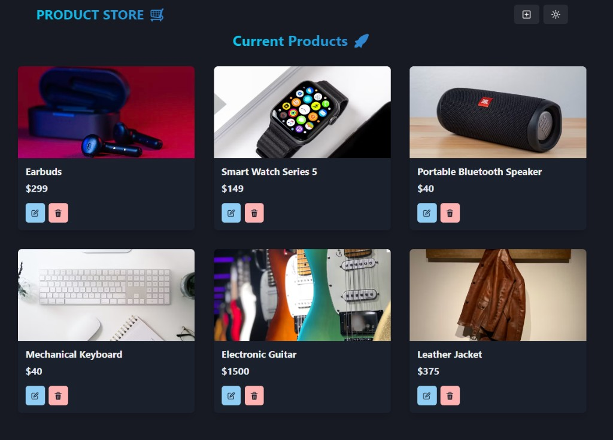

# Product Store

A full-stack web app for managing a catalog of products. A React single-page app talks to a Node.js/Express REST API that stores data in MongoDB.



## Features

- Browse all products in a responsive card grid
- Add a product with a name, price and image URL
- Edit a product from a pop-up form
- Delete a product
- Light and dark mode
- Instant UI updates after every action, without reloading the page
- Error handling on the API (input checks, invalid IDs, missing products) with success and error messages in the UI

## Tech Stack

**Backend**
- Node.js and Express - HTTP server and REST API
- MongoDB with Mongoose - database and schema/model layer (works with MongoDB Atlas or a local MongoDB)
- dotenv - loads configuration from a `.env` file
- nodemon - restarts the server automatically during development

**Frontend**
- React - UI library
- Vite - dev server and build tool (also proxies `/api` calls to the backend in development)
- React Router - client-side routing between pages
- Chakra UI - component library used for layout, forms, toasts and dark/light mode
- Zustand - lightweight global state store that also holds the API calls
- react-icons and @chakra-ui/icons - icons (e.g. theme toggle, edit, delete)
- ESLint - linting

## Project Structure

```
.
├── backend
│   ├── server.js                      Entry point: Express app, middleware, routes
│   ├── config/db.js                   MongoDB connection
│   ├── models/product.model.js        Mongoose schema (name, price, image)
│   ├── routes/product.route.js        Maps HTTP method + URL to a controller
│   └── controllers/product.controller.js   CRUD logic and responses
├── frontend
│   ├── vite.config.js                 Vite config and /api proxy
│   └── src
│       ├── main.jsx                   Entry point: providers and router
│       ├── App.jsx                    Layout and routes
│       ├── pages/                     HomePage (list), CreatePage (form)
│       ├── components/                Navbar, ProductCard
│       └── store/product.js           Zustand store (state + API calls)
├── .env.example                       Required environment variables
└── package.json                       Backend dependencies and scripts
```

## How It Works

1. The browser loads the React app served by Vite (http://localhost:5173).
2. The app calls relative URLs such as `/api/products`.
3. In development, Vite forwards every `/api` request to the Express server on port 5000.
4. Express routes the request to a controller, which reads or writes MongoDB through Mongoose and returns JSON.
5. The Zustand store updates its state and React re-renders the UI.

## API

Base path: `/api/products`

| Method | Endpoint | Description |
|--------|----------|-------------|
| GET    | `/api/products`     | Get all products |
| POST   | `/api/products`     | Create a product (`name`, `price`, `image` required) |
| PUT    | `/api/products/:id` | Update a product |
| DELETE | `/api/products/:id` | Delete a product |

Responses use the shape `{ "success": true, "data": ... }` or `{ "success": false, "message": "..." }`, with status codes 200, 201, 400, 404 and 500.

## Getting Started

### Prerequisites

- Node.js (v20.19 or newer) and npm
- Git
- A MongoDB database (a free MongoDB Atlas cluster or a local MongoDB instance)

### Installation

1. Clone the repository and enter the project folder:

```bash
git clone https://github.com/itaimarcus/product-store.git
cd product-store
```

2. Install the backend dependencies (project root) and the frontend dependencies:

```bash
npm install
cd frontend
npm install
cd ..
```

3. Create a MongoDB database and get its connection string:
   - Create a free cluster at [MongoDB Atlas](https://www.mongodb.com/atlas).
   - Create a database user (Database Access).
   - Allow your IP address (Network Access).
   - Click Connect > Drivers and copy the connection string. Put your database name in it (for example `products`) and replace the password placeholder.
   - If you use a local MongoDB instead, the string is `mongodb://localhost:27017/products`.

4. Create a `.env` file in the project root by copying `.env.example`:

```bash
cp .env.example .env
```

On Windows PowerShell, use `copy .env.example .env`. Then open `.env` and fill in your values:

```
MONGO_URI=your_mongodb_connection_string
PORT=5000
```

`PORT` must stay `5000` unless you also change the proxy target in `frontend/vite.config.js`.

### Run

Start the backend (from the project root):

```bash
npm run dev
```

You should see `Server started at http://localhost:5000` and `MongoDB Connected: ...`.

Start the frontend (in a second terminal):

```bash
cd frontend
npm run dev
```

Open http://localhost:5173. Both servers must be running at the same time.

### Troubleshooting

- **`querySrv ECONNREFUSED` when starting the backend:** your network or DNS setup blocks the lookup that `mongodb+srv://` connection strings use. In Atlas, choose the older standard connection string (it starts with `mongodb://` and lists the servers) and use it as `MONGO_URI`.
- **Server cannot connect to Atlas:** check that your current IP address is in the Atlas Network Access list.
- **`502 Bad Gateway` in the browser:** the backend is not running or crashed. Check the backend terminal.

### Scripts

| Location | Command | Description |
|----------|---------|-------------|
| root | `npm run dev` | Start the API with nodemon |
| frontend | `npm run dev` | Start the Vite dev server |
| frontend | `npm run build` | Create a production build in `frontend/dist` |
| frontend | `npm run preview` | Preview the production build |
| frontend | `npm run lint` | Run ESLint |

## Possible Improvements

- Authentication
- Stronger input validation
